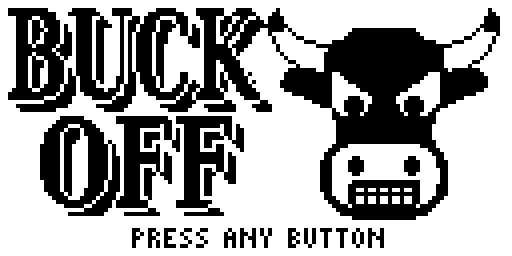
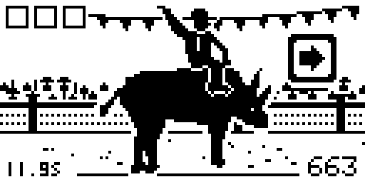
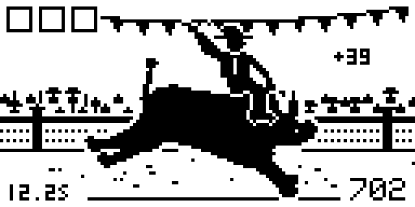
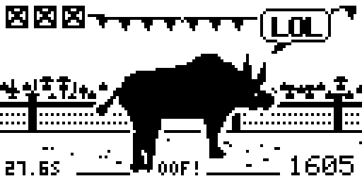
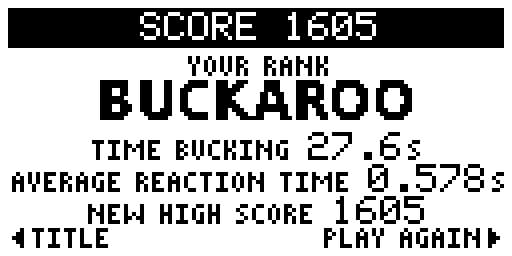
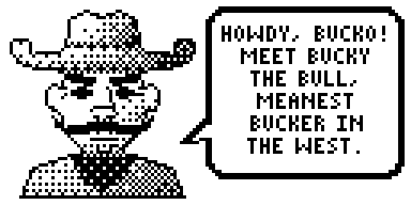
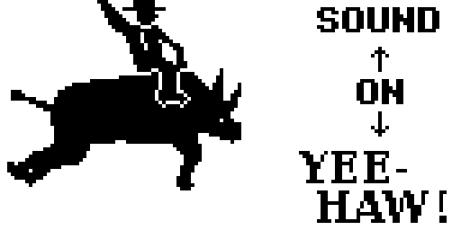

# Buck Off



Stay on Bucky the Bull as long as you can. A button pops up next to the bull: press
it fast and he bucks the way you pushed. Too slow, or the wrong button, and you slip.
Three slips and you're bucked off.

By **jaychugstein** · MIT License · Arduboy FX / FX-C (uses the FX flash chip).

**Play it in your browser:** https://jaychugstein.github.io/Buck-Off/ (works on phones too)

 
 

## Controls

| Button | What it does |
|---|---|
| Up / Down / Left / Right, A, B | Press the one shown on screen, fast |
| Up / Down | Sound on or off (sound screen) |
| A or B | Next screen · finish or turn the cowboy's speech bubble |
| Right | Ride again (score screen) |
| Left | Back to the title (score screen) |

A is the outer button and B is the inner one, as on the POOM.

## How a ride works

- A prompt pops up in the open space around the bull: an arrow, or a round A or B.
- Press it before it runs out and the bull bucks. Each button has its own move:
  rear up, kick, lunge, drop, leap and spin (on the spin, the cowboy waves his hat).
- Too slow or the wrong button is a strike (top left). Three strikes and you're
  thrown up in the air and kicked clean off the screen.
- Eight hits in a row wipes a strike.
- It gets faster the longer you ride: 1.3 seconds to react at the start, about
  0.75 s at 20 seconds, 0.45 s at 40 seconds, never less than 0.3 s.
  Most rides last 25 to 40 seconds.

## Scoring

- Every hit: 10 points, plus up to 90 more for how much of the time you had left.
- Every 7 seconds without a strike: +250.
- Reaction times are measured to the millisecond, from the moment the prompt
  reaches the screen to the moment you press, not frame by frame.
- The score screen shows your time bucking, your average reaction time and your
  high score (saved).

### Ranks

| Rank | Score |
|---|---|
| Ground Beef | 0 |
| Hay Bale | 100 |
| Dust Eater | 250 |
| Buck Boy | 450 |
| Rodeo Clown | 700 |
| Saddle Sore | 1,000 |
| Buckaroo | 1,350 |
| Buckshot | 1,750 |
| Buck Wild | 2,200 |
| Ball Buster | 2,700 |
| Big Bucks | 3,300 |
| Bull Whisperer | 4,000 |
| Rodeo Legend | 4,800 |
| Buck Almighty | 6,000 |

 

## Install

Load `release/BuckOff.arduboy` with any FX-aware uploader (for example the
Arduboy Web Flasher or the Arduboy-Python-Utilities), or the `.hex` together
with `release/BuckOff-fxdata.bin`.

The game is built with `ARDUBOY_NO_USB` to save space, like most cart games:
to upload something else afterwards, press reset when the uploader asks.

## Building from source

The sketch is in `BuckOff/` and needs the **Arduboy2**, **ArduboyFX** and
**ArduboyTones** libraries. The source sets a few size-saving compiler options
itself (top of `BuckOff.ino`).

* **Arduino IDE:** open `BuckOff/BuckOff.ino`, pick an Arduboy board,
  compile, then upload `BuckOff/fxdata/fxdata.bin` as the FX data.
* **Command line:** `./build.sh` (edit the paths at the top) → `build/BuckOff.hex`.

All the art is drawn by Python scripts in `art/` (needs numpy, scipy and Pillow)
and packed into the FX data:

```
cd art
python3 head.py && python3 title.py && python3 frames.py
python3 controls.py && python3 bucko.py
python3 fxpack.py      # writes BuckOff/fxdata/fxdata.bin, BuckOff/fxdata.h and BuckOff/tables.h
```

The lettering uses the DejaVu fonts (DejaVu Serif Condensed Bold and DejaVu Sans
Condensed Bold, free license). The music is *Oh! Susanna* by Stephen Foster (1848,
public domain).

## Browser version

`docs/` is a small web page that runs the real game file in the
[Ardens](https://github.com/tiberiusbrown/Ardens) emulator (MIT, by Peter Brown).
It's served by GitHub Pages from the `docs` folder.

## License

MIT — see [LICENSE](LICENSE). Uses the Arduboy2 (BSD 3-Clause), ArduboyFX (CC0) and
ArduboyTones (BSD 3-Clause) libraries; `BuckOff/font.h` is the Arduboy2 font.
